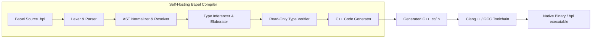
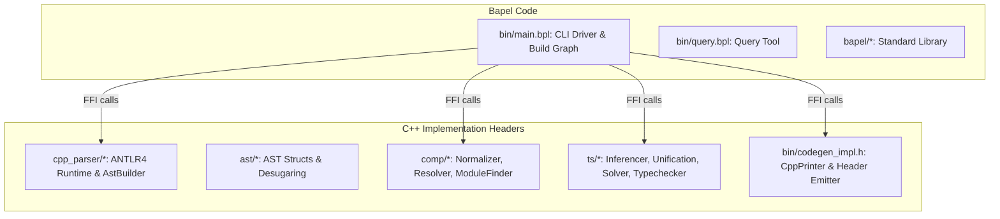
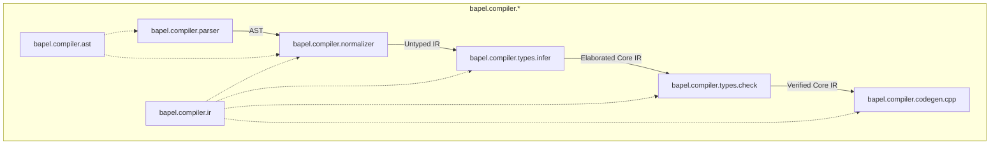
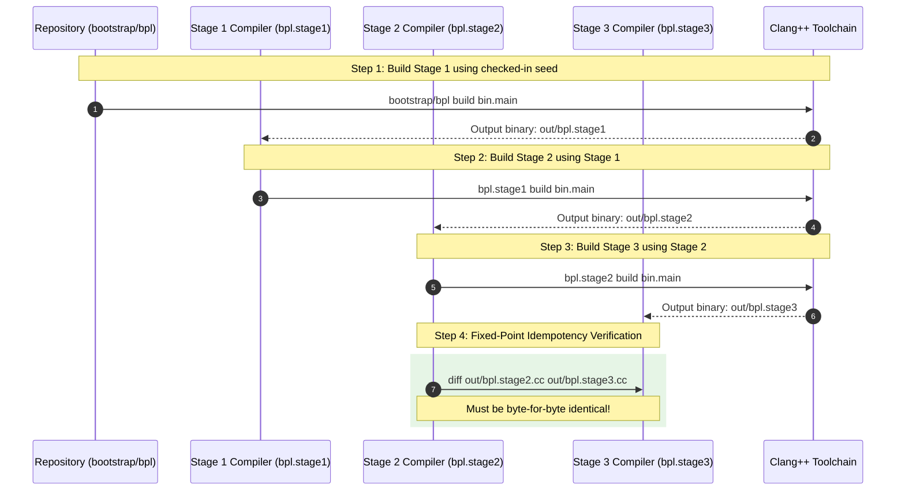
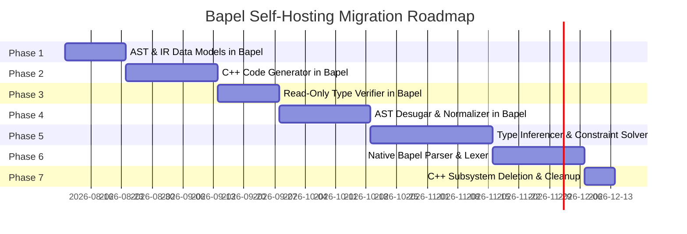
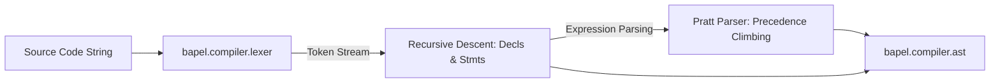
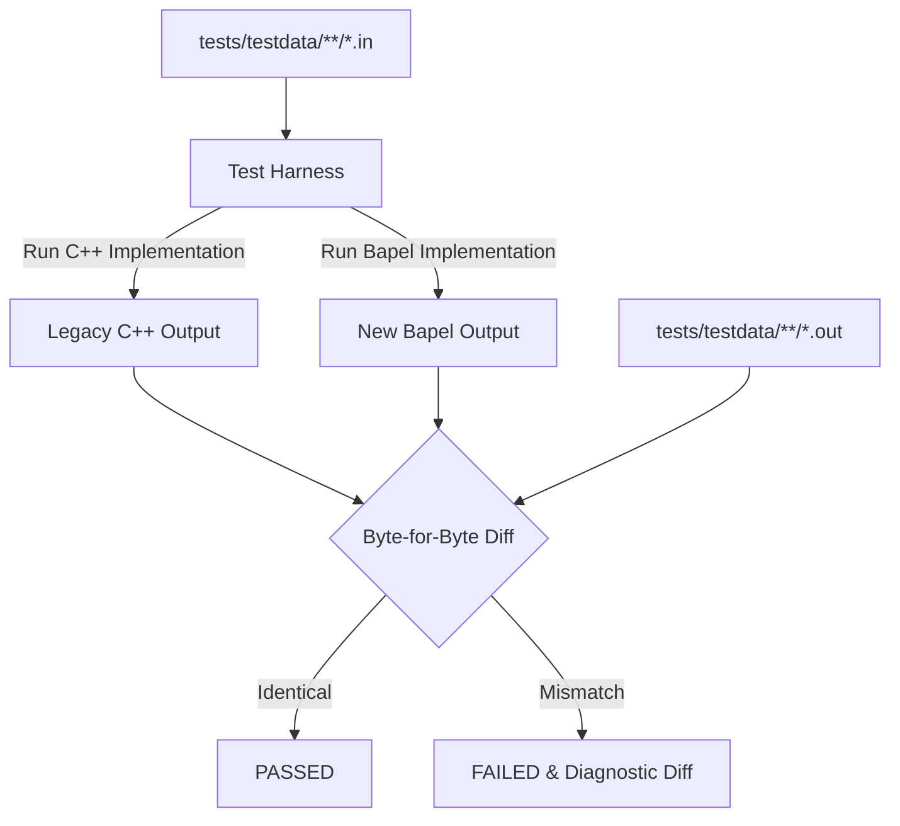

# Self-Hosting Bapel: Compiler Bootstrapping and Migration Design

This document outlines the architecture, bootstrapping lifecycle, and incremental migration plan to port the Bapel compiler from its current hybrid C++ implementation to a fully self-hosting compiler written in Bapel itself.

---

## 1. Executive Summary & Goals

### Vision
Bapel's long-term goal is to achieve **full self-hosting**, where the compiler pipeline (lexing, parsing, normalization, type inference, elaboration, verification, and code generation) is implemented entirely in Bapel source code (`.bpl`). The only external dependencies should be:
1. A checked-in seed compiler binary ([`bootstrap/bpl`](../bootstrap/bpl)) used to build the compiler from source.
2. A standard C++ compiler toolchain (e.g. `clang++`) to compile the generated C++ emission into native machine code.



### Core Objectives
* **Zero C++ Compiler Logic**: Eliminate all compiler logic written in C++ ([`ast/`](../ast), [`comp/`](../comp), [`ts/`](../ts), [`cpp_parser/`](../cpp_parser), and [`bin/codegen_impl.h`](../bin/codegen_impl.h)), replacing them with idiomatic Bapel modules.
* **Incremental, Non-Breaking Migration**: Employ an incremental migration strategy via Bapel's C++ FFI (`impls` & `@bpl` bindings) so the compiler remains functional, passes all golden tests, and bootstraps at every single commit.
* **Deterministic Multi-Stage Bootstrapping**: Establish a rigorous 3-stage bootstrapping harness with fixed-point verification to ensure compiler determinism and guard against compiler regressions.
* **Language Dogfooding**: Exercise Bapel's algebraic data types, pattern matching, traits, and linear memory model on a production-scale codebase.

---

## 2. Current Architecture vs. Target Architecture

### 2.1 Current State (Hybrid Compiler)

The Bapel compiler is currently split between a top-level Bapel driver and a C++ compiler backend:



| Component | Current Implementation | Target Bapel Module |
| :--- | :--- | :--- |
| **CLI & Driver** | [`bin/main.bpl`](../bin/main.bpl) (Bapel) | `bapel.compiler.driver` |
| **Query Engine** | [`bin/query.bpl`](../bin/query.bpl) (Bapel) | `bapel.compiler.query` |
| **Lexer & Parser** | [`cpp_parser/`](../cpp_parser) (ANTLR4 C++ Runtime) | `bapel.compiler.parser` |
| **AST Definitions** | [`ast/`](../ast) (C++ structs & variants) | `bapel.compiler.ast` |
| **IR Definitions** | [`bin/ir_*.h`](../bin) (C++ classes) | `bapel.compiler.ir` |
| **Desugar & Normalize** | [`comp/normalizer.h`](../comp/normalizer.h), [`comp/resolver.h`](../comp/resolver.h) | `bapel.compiler.normalizer` |
| **Type Inference** | [`ts/inferencer.h`](../ts/inferencer.h), [`ts/solver.h`](../ts/solver.h) | `bapel.compiler.types.infer` |
| **Type Verification** | [`ts/typecheck.h`](../ts/typecheck.h) (C++ kernel) | `bapel.compiler.types.check` |
| **C++ Emitter** | [`bin/codegen_impl.h`](../bin/codegen_impl.h) (C++ `CppPrinter`) | `bapel.compiler.codegen.cpp` |

### 2.2 Target Self-Hosting Architecture

In the self-hosting architecture, all compiler components are pure Bapel modules under the `bapel.compiler.*` namespace:



---

## 3. The Bootstrapping Lifecycle

Bootstrapping a self-hosting compiler requires a reproducible multi-stage compilation process.



### 3.1 The Three Stages Defined

1. **Stage 0 (`bootstrap/bpl`)**: The precompiled, immutable seed binary stored in the git repository. This binary is only executed when building the development compiler from a clean checkout.
2. **Stage 1 (`out/bpl.stage1`)**: Compiled by Stage 0 using the current working copy of the compiler source code. It incorporates all local changes in the working tree, but was compiled by the previous compiler version.
3. **Stage 2 (`out/bpl.stage2`)**: Compiled by Stage 1 using the current working copy of the compiler source code. This is the first binary that is both **built from** and **built by** the new compiler source code.
4. **Stage 3 (`out/bpl.stage3`)**: Compiled by Stage 2. Used solely for **fixed-point idempotency verification**.

### 3.2 Fixed-Point Idempotency Verification

A self-hosting compiler must be a mathematical fixed point:

$$\text{Compiler}(\text{Source}) = \text{Compiler}$$

Because binary executables can embed non-deterministic metadata (timestamps, build paths, random symbol offsets), Bapel validates fixed-point equivalence at the **generated C++ code level**:

```bash
# Verify that Stage 2 and Stage 3 produce identical C++ emission
diff -u out/stage2_generated.cc out/stage3_generated.cc
```

If the generated C++ files are identical, `bpl.stage2` is proven deterministic and can be promoted.

### 3.3 Promotion Protocol (`make bootstrap`)

The seed compiler [`bootstrap/bpl`](../bootstrap/bpl) is updated via a dedicated Makefile target:

```makefile
.PHONY: bootstrap-verify
bootstrap-verify: bpl
	# Build Stage 2
	./bpl build bin.main -o out/stage2/bpl
	# Build Stage 3
	./out/stage2/bpl build bin.main -o out/stage3/bpl
	# Verify fixed point
	diff -r out/stage2/src out/stage3/src
	@echo "Bootstrapping fixed point verified!"

.PHONY: bootstrap-promote
bootstrap-promote: bootstrap-verify
	cp out/stage2/bpl bootstrap/bpl
	@echo "bootstrap/bpl successfully promoted."
```

---

## 4. Incremental Migration Plan

Rewriting the entire compiler in one massive PR is error-prone. Instead, we use the **Strangler Fig Pattern**, porting one pipeline stage at a time from C++ to Bapel.



---

### Phase 1: AST and IR Data Models in Bapel

**Goal**: Define Bapel-native algebraic data types for the compiler's intermediate representations ([`ast/`](../ast) and [`bin/ir_*.h`](../bin)).

#### Implementation Steps
1. Create `bapel/compiler/ast.bpl`:
   * Represent AST nodes using Bapel `struct` and `variant` types:
   ```bapel
   module bapel.compiler.ast

   pub type Pos = struct {
     filename: String,
     line: i64,
     col: i64
   }

   pub type Expr = variant {
     Var: struct { name: String, pos: Pos },
     LitInt: struct { value: i64, pos: Pos },
     LitString: struct { value: String, pos: Pos },
     App: struct { callee: &&Expr, args: Vector Expr, pos: Pos },
     Let: struct { name: String, typ: Maybe TypeExpr, val: &&Expr, body: &&Expr, pos: Pos },
     Match: struct { target: &&Expr, arms: Vector MatchArm, pos: Pos }
   }
   ```
2. Create `bapel/compiler/ir.bpl`:
   * Define Core IR terms, types, and units matching [`designs/typechecking.md`](typechecking.md).
3. Bridge C++ and Bapel data structures using serialization or C++ FFI translation helpers during the transition period.

---

### Phase 2: C++ Code Generator in Bapel

**Goal**: Port [`bin/codegen_impl.h`](../bin/codegen_impl.h) (`CppPrinter`) to pure Bapel in `bapel/compiler/codegen_cpp.bpl`.

#### Rationale for Early Port
* **High ROI**: Code generation is a pure tree-walking transformation from `IrUnit` to `String`. It does not require complex graph algorithms or constraint solvers.
* **Immediate Feedback**: The existing golden test suite ([`tests/cpp_printer_test.cc`](../tests/cpp_printer_test.cc)) and Clang validity checks ([`tests/test_main.cc`](../tests/test_main.cc)) can validate the output of the new Bapel code generator against the C++ code generator.

#### Key Modules to Port
* Type emission & name mangling (`bapel::inherents::*`, `bapel::traits::*`).
* Struct and variant C++ struct emission (`std::variant`, tagged unions).
* SFINAE template constraints for trait bounds (from [`designs/traits.md`](traits.md)).
* Statement vs. expression translation (`ifthen`, `ifelse`, `core::for`, block expressions).

---

### Phase 3: Core Read-Only Typechecker in Bapel

**Goal**: Port the trusted verification kernel ([`ts/typecheck.h`](../ts/typecheck.h)) to `bapel/compiler/types/check.bpl`.

#### Architecture
As defined in [`designs/typechecking.md`](typechecking.md), Stage 2 of the type system is a **deterministic, read-only kernel**:
* Zero unification variables (`evars`).
* Zero constraint solving or heuristic search.
* Simple bottom-up type validation:
  $$\frac{\Gamma \vdash f : A \to B \quad \Gamma \vdash x : A}{\Gamma \vdash f\ x : B}$$

```bapel
module bapel.compiler.types.check

pub fn verify_term(ctx: &Context, term: &IrTerm) -> Result () TypeError {
  match *term {
    IrTerm::App (callee, arg) => {
      let callee_type: IrType = infer_type (ctx, &callee)?;
      match callee_type {
        IrType::Function (param, ret) => {
          verify_term_against (ctx, &arg, &param)?;
          Result::Ok ()
        },
        _ => Result::Err (TypeError::NotAFunction { actual: callee_type })
      }
    },
    // ...
  }
}
```

---

### Phase 4: AST Desugar & Normalizer in Bapel

**Goal**: Port [`ast/ast_desugar.h`](../ast/ast_desugar.h), [`comp/desugar.h`](../comp/desugar.h), [`comp/normalizer.h`](../comp/normalizer.h), and [`comp/resolver.h`](../comp/resolver.h) to `bapel/compiler/normalizer.bpl`.

#### Key Responsibilities
1. **Syntactic Desugaring**:
   * Desugar `while` loops into infinite `loop` with `break`.
   * Desugar `@derive` attributes into trait implementations.
   * Expand `impl Trait` parameter syntax into explicit forall type parameters.
2. **Module Discovery & Import Resolution**:
   * Implement topological sorting of imported modules as specified in [`designs/module-discovery.md`](module-discovery.md).
   * Verify module header coherence (`module $ID` vs `implements $ID`).
3. **Trait Coherence & Orphan Rule Verification**:
   * Enforce the Same-File / Same-Module coherence rule from [`designs/traits.md`](traits.md).

---

### Phase 5: Type Inferencer & Constraint Solver in Bapel

**Goal**: Port the type inferencer ([`ts/inferencer.h`](../ts/inferencer.h)), unification engine ([`ts/unify.h`](../ts/unify.h)), and trait solver ([`ts/solver.h`](../ts/solver.h)) to `bapel/compiler/types/infer.bpl`.

#### Key Responsibilities
1. **Bidirectional Inference**:
   * Implement synthesis ($\Gamma \vdash e \Rightarrow \tau$) and checking ($\Gamma \vdash e \Leftarrow \tau$).
2. **Unification & Substitution**:
   * Union-find structure for existential type variables (`evars`).
   * Occurs-check and kind-directed unification.
3. **Elaboration & Receiver Adjustment**:
   * Rewrite method calls `x.foo()` to qualified calls `Type::foo(&x)`.
   * Insert automatic borrowing (`Ptr::mk`) and dereferencing (`Ptr::get`).
4. **Zonking**:
   * Final pass to replace all solved `evars` with concrete types, producing fully annotated Core IR.

---

### Phase 6: Native Bapel Parser & Lexer

**Goal**: Replace the ANTLR4 C++ parser ([`cpp_parser/`](../cpp_parser)) with a native Bapel parser in `bapel/compiler/parser.bpl`.

#### Architecture Choice: Hand-Written Recursive Descent + Pratt Parser
Rather than bringing a heavy ANTLR runtime dependency into Bapel, the self-hosting compiler will use a **hand-written Recursive Descent parser with Pratt parsing for expressions**:
* **Zero External Dependencies**: Compiles cleanly with standard library only.
* **Precise Error Diagnostics**: Full control over error recovery, span reporting, and custom suggestions.
* **High Performance**: Single-pass, zero-allocation token streaming.



---

### Phase 7: C++ Subsystem Deletion & Cleanup

**Goal**: Remove all remaining legacy C++ compiler code and finalize the self-hosting build system.

#### Deletion Checklist
* [ ] Delete `cpp_parser/` (including ANTLR grammar `bapel.g4` and generated files).
* [ ] Delete `ast/` C++ headers (`ast.h`, `ast_decl.h`, `ast_expr.h`, etc.).
* [ ] Delete `comp/` C++ headers (`normalizer.h`, `resolver.h`, `typecheck_unit.h`, etc.).
* [ ] Delete `ts/` C++ headers (`inferencer.h`, `solver.h`, `unify.h`, `context.h`, etc.).
* [ ] Delete `bin/codegen_impl.h` and `bin/ir_*.h`.
* [ ] Update `Makefile` so that `make all` and `make test` rely exclusively on `bootstrap/bpl` and the Clang backend.

---

## 5. Testing & Verification Strategy

During the migration, both the legacy C++ implementations and new Bapel implementations will be tested side-by-side using the test framework established in [`designs/tests.md`](tests.md).



### 5.1 Golden Test Preservation
* All existing test suites (`parse`, `normalize`, `infer`, `typecheck`, `cpp_codegen`, `cpp_compile`) in [`tests/testdata/`](../tests/testdata) remain the authoritative golden standard.
* Ported Bapel components must produce **100% byte-for-byte identical output** to existing golden `.out` files.

### 5.2 Compiler Dogfood Test Suite
Add a dedicated self-compilation test in `tests/`:
```bash
# Test that the compiler can parse, typecheck, and compile its own source files
./bpl build bapel.compiler.ast
./bpl build bapel.compiler.ir
./bpl build bapel.compiler.parser
./bpl build bapel.compiler.normalizer
./bpl build bapel.compiler.types
./bpl build bapel.compiler.codegen.cpp
./bpl build bin.main
```

---

## 6. Risks, Mitigations & Alternatives

| Risk | Impact | Mitigation Strategy |
| :--- | :--- | :--- |
| **Compiler Bug Breaks Bootstrapping** | High (Broken build prevents compiling a fix) | Keep `bootstrap/bpl` immutable in git. Revert local compiler binary or run with previous stable seed until fix is applied. |
| **Performance Degradation** | Medium (Slower compiler builds) | Leverage Bapel's Linear Memory Model ([`designs/lmm.md`](lmm.md)) and efficient `bapel.stl.Vector` / `StringView` representations to minimize heap allocations. |
| **Large PR / Integration Disruption** | High | Enforce incremental phase-by-phase migration using FFI bindings so each component merges independently. |
| **Differences in ANTLR vs Pratt Parsing** | Medium (Grammar ambiguities) | Maintain comprehensive golden tests for syntax edge-cases and error diagnostics. |

---

## 7. Summary & Next Steps

1. **Review & Approval**: Align on the phase order (AST $\to$ Codegen $\to$ Verifier $\to$ Normalizer $\to$ Inferencer $\to$ Parser $\to$ Cleanup).
2. **Phase 1 Kickoff**: Begin defining `bapel/compiler/ast.bpl` and `bapel/compiler/ir.bpl`.
3. **CI Bootstrapping Job**: Add multi-stage fixed-point verification to the test runner.
